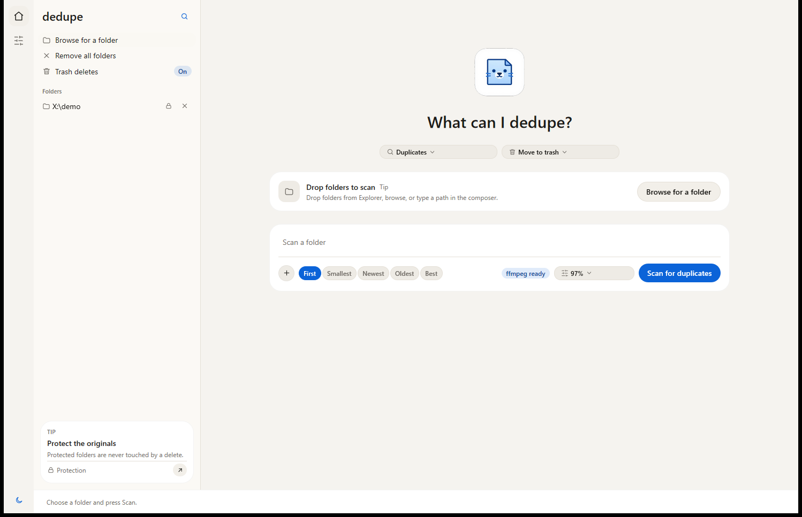
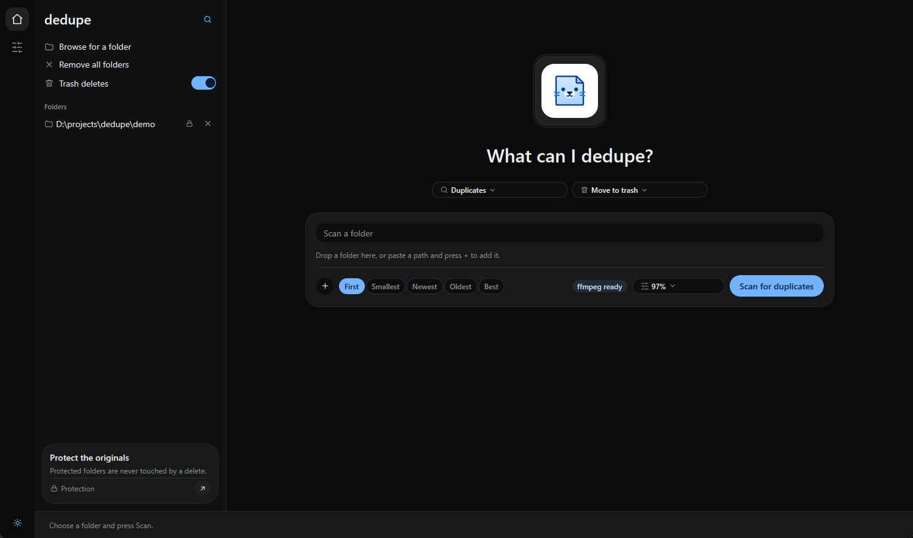
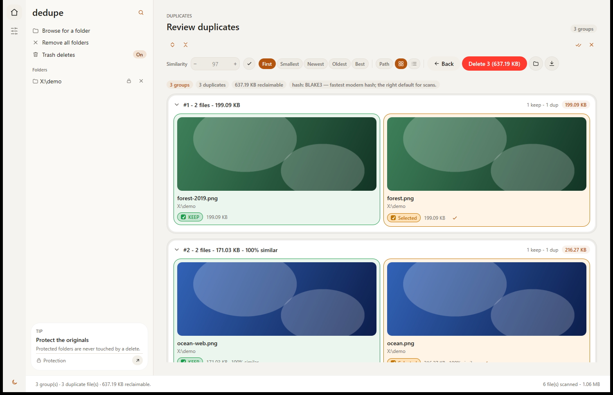
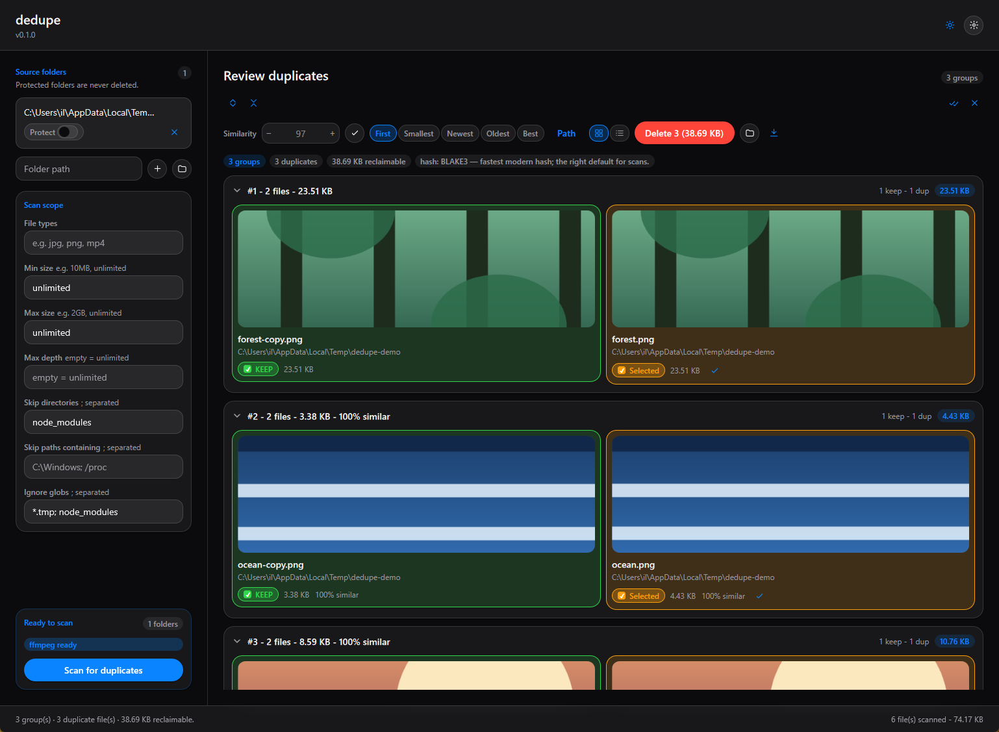
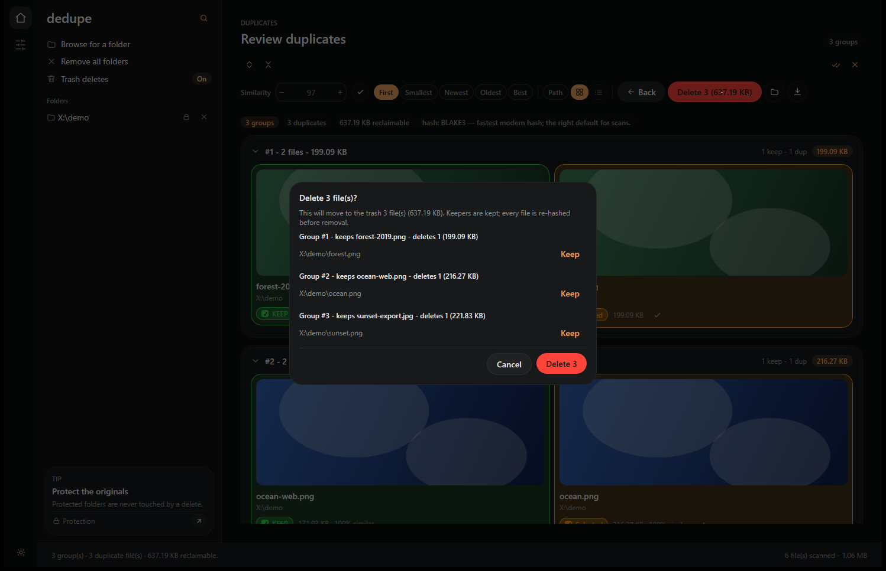

# dedupe


Finds duplicate files — exact copies, and the same photo or video saved twice in a
different format.

Windows, macOS and Linux. One binary: open the desktop app, or run a scan from the
terminal.

## Screenshots

| Home, light | Home, dark |
| --- | --- |
|  |  |

| Results, light | Results, dark | Before deleting |
| --- | --- | --- |
|  |  |  |

## What it finds

- **Exact duplicates** — same bytes, whatever the file is called or wherever it sits.
- **Similar media** (on by default) — the same picture re-saved as `.png` or `.jpg`,
  the same clip re-encoded to `.mov`. Turn it off with `--exact`.
- **Disk clutter** — empty files and folders, temp files, broken symlinks,
  mislabelled extensions, bad names, the biggest files in a folder, duplicate
  folders, and duplicate music.

## Desktop app

Run `dedupe` with no arguments (or `dedupe --gui`).

1. Pick a folder on the left and press **Scan**.
2. Results are grouped by content. Green **KEEP** is the copy that stays, amber
   **Selected** is ticked for deletion.
3. **Delete** follows your Trash setting: with it on the ticked copies go to the
   system trash, with it off they are deleted permanently. The dialog lists the
   groups and files that will go first — a long selection is summarized with
   counts. **Stop** cancels a scan instantly.

Folders can be marked as **protected**: their copies win the keep decision and
are never deleted (duplicate scans). The keep rule (First / Smallest / Newest /
Oldest / Best quality) can be changed without rescanning, and **Consolidate**
gathers one copy of every group into a folder of your choosing, leaving protected
keepers where they are. Settings also cover the scan type, match mode, image
fingerprint and partial clips; light/dark and your preferences persist between
runs.

## Command line

```sh
dedupe ~/Pictures                             # scan and report
dedupe ~/Photos --delete --trash              # review each group, delete to the trash
dedupe /incoming /backup --reference-dir /backup -Dy --trash   # backup always wins
dedupe ~/photos --consolidate-dir ~/sorted -y # gather one copy of everything
dedupe ~/photos --move-dir D:\quarantine -y   # move duplicates aside instead
dedupe ~/photos --hardlink -y                 # replace copies with hard links
dedupe ~/photos --strip-exif -y               # strip EXIF/XMP in place
dedupe ~/downloads --find empty-dirs -D --trash -y  # cleanup scan
dedupe ~/music --find music --music-by content      # needs FFmpeg
dedupe ~/photos --match fuzzy --fuzzy-threshold 90
dedupe ~/photos --csv report.csv --html report.html
```

`--delete` on its own removes files permanently; add `--trash`, or leave out `-y`
to be asked before anything goes.

Useful flags:

| Flag | What it does |
| --- | --- |
| `--find MODE` | Cleanup mode: `empty-files`, `empty-dirs`, `big-files`, `temp-files`, `invalid-symlinks`, `broken-files`, `bad-extensions`, `bad-names`, `duplicate-folders`, `music` |
| `--match` | Group by `content` (default), `size`, `name` or `fuzzy` |
| `--similarity PCT` | How close two images/videos must be (default 97) |
| `--image-hash` | `auto` (dHash), `phash`, `ahash` or `color` |
| `--partial-clips` | Also match a short clip found inside a longer one |
| `--trash` / `--dry-run` | Move to the system trash instead of deleting; or only list what would go |
| `--reference-dir` | Never delete copies here (repeatable, duplicate scans; scan the folder too) |
| `--jobs N` | Worker threads (`0` = all but one core) |
| `--json` / `--csv` / `--html` | Machine-readable, spreadsheet or shareable report |

`dedupe --help` has the full list.

## Is my data safe?

- Duplicates are re-hashed immediately before they are removed, and a copy that
  changed meanwhile is skipped. Cleanup findings are re-checked for type and size
  instead, since there is no second copy to compare against.
- Duplicate deletions ask once per group unless you pass `-y`; cleanup deletions
  ask once for the whole list. `--trash` moves files to the system trash, where
  they can be restored, instead of removing them outright.
- `--dry-run`, `--move-dir` and `--hardlink` give you ways to clean up without
  losing anything.
- Re-scans are fast: unchanged files are skipped using the size + mtime caches in
  `~/.dedupe/`. `--no-cache` bypasses them without refreshing them;
  `--clear-cache` wipes them.

## Build

```sh
.\build.ps1            # Windows: release binary copied to .\dedupe.exe
cargo build --release  # any OS
```

Rust is the only requirement on Windows and macOS. On Linux the GUI stack also
needs its development packages, as CI installs them: `gcc`, `g++`, `clang`,
`libgtk-4-dev`, `libgstreamer1.0-dev`, `libgstreamer-plugins-base1.0-dev` and
`libwayland-dev`.

FFmpeg is optional for most scans: it adds resolution, duration and codec info,
video comparison, and audio fingerprints for `--music-by content`.

Release downloads: `dedupe.exe` on Windows, the bare binary plus a `dedupe.desktop`
launcher on Linux (put the binary on `PATH` or point `Exec=`/`TryExec=` at it), and
a `dedupe.app` bundle next to the binary on macOS. The GUI never opens a terminal
window on any platform.

## How it works

1. Walk the paths, apply the type/size/depth/exclude filters.
2. Group by size, collapse hard links, then partial-hash and fully hash what is
   left (`blake3` by default).
3. Fingerprint the remaining images and videos (dHash on a 17×16 thumbnail; 8
   frames for video) and cluster them at the similarity threshold.
4. Report what can be reclaimed, or delete it after a re-hash.

## Development

```sh
cargo test
cargo clippy --all-targets
```

Commits run `cargo fmt`, `cargo clippy` and file hygiene checks through
[prek](https://prek.j178.dev/), the same ones CI uses (`prek.toml`):

```sh
prek install          # check automatically on commit
prek run --all-files  # check everything now
```

## License

MIT
