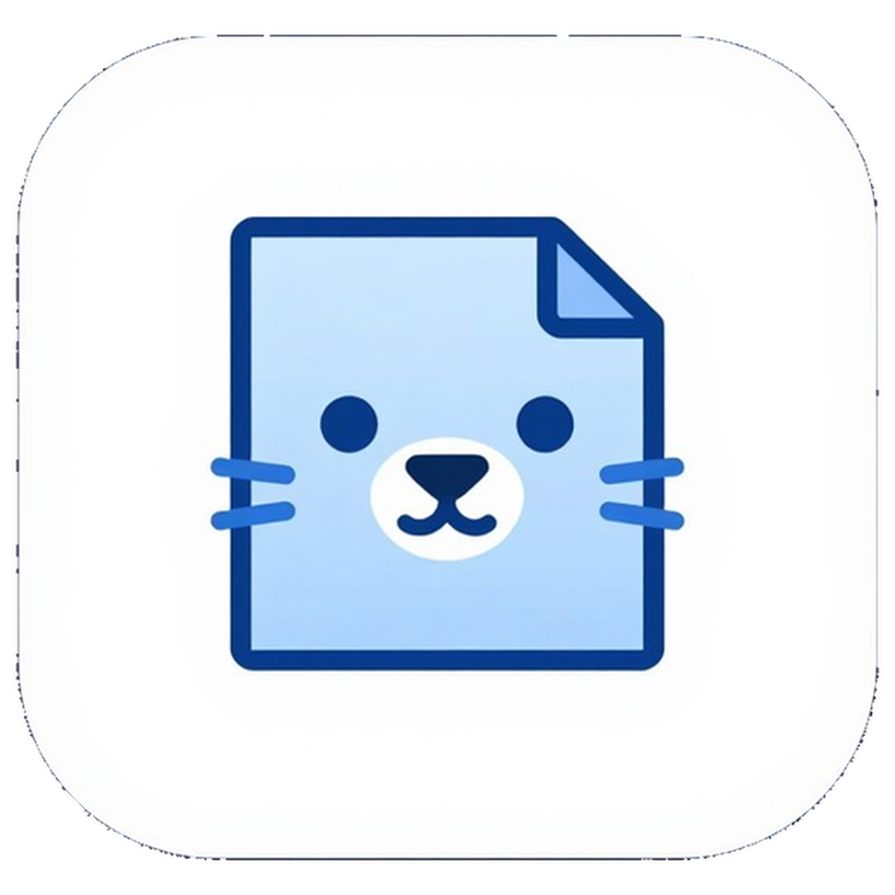
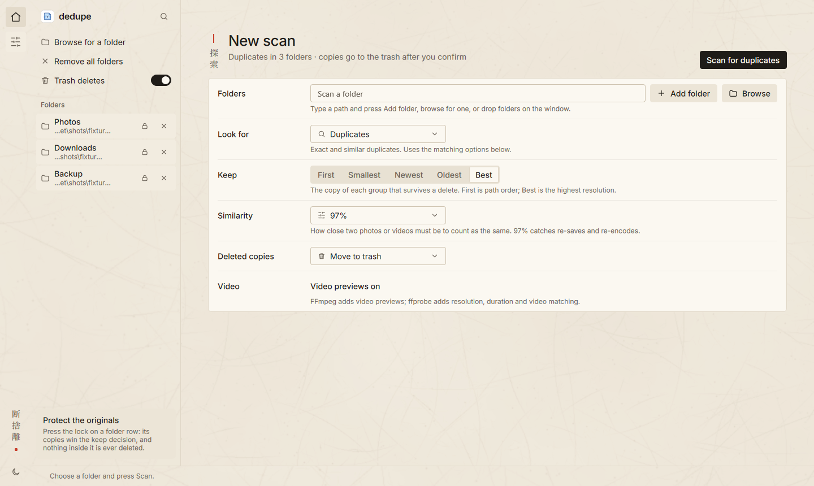
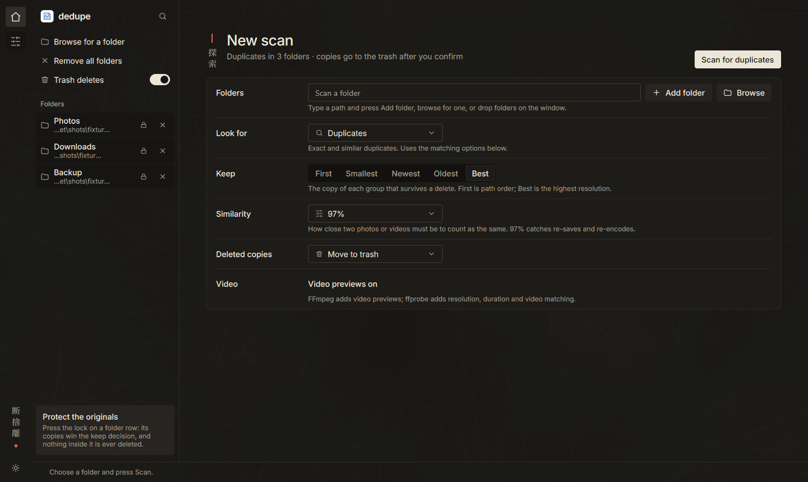
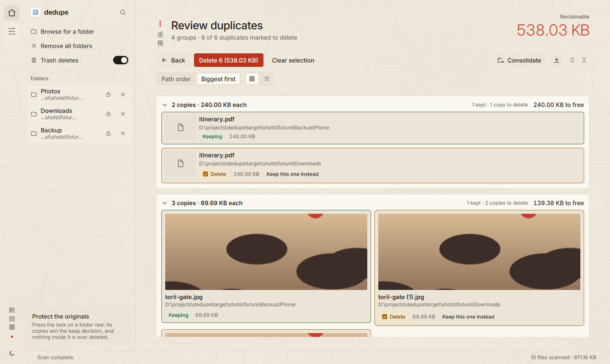
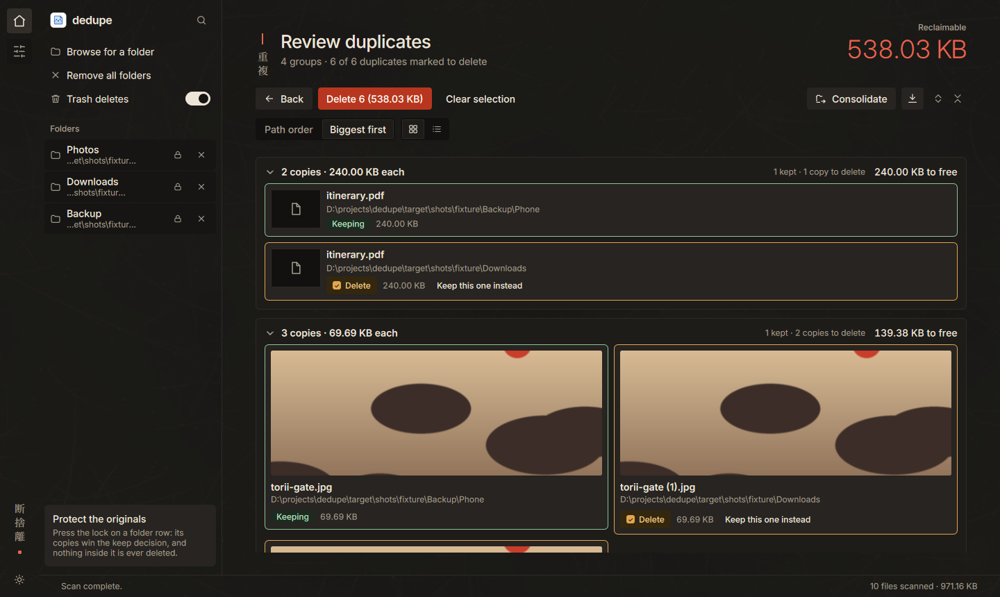
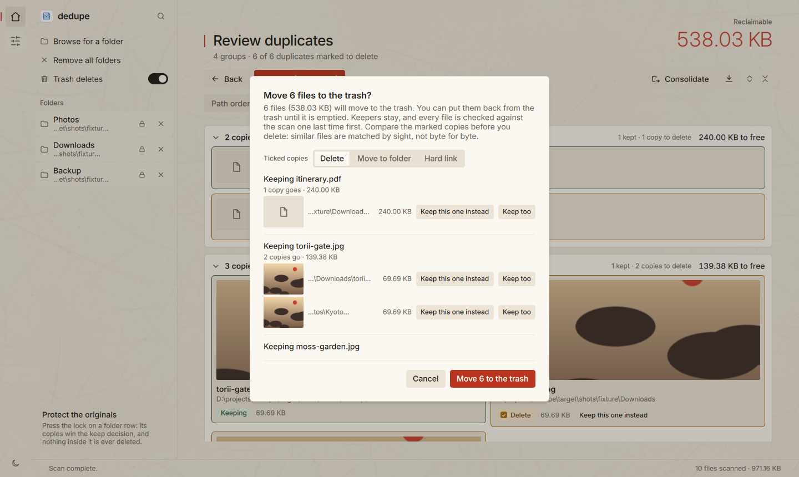
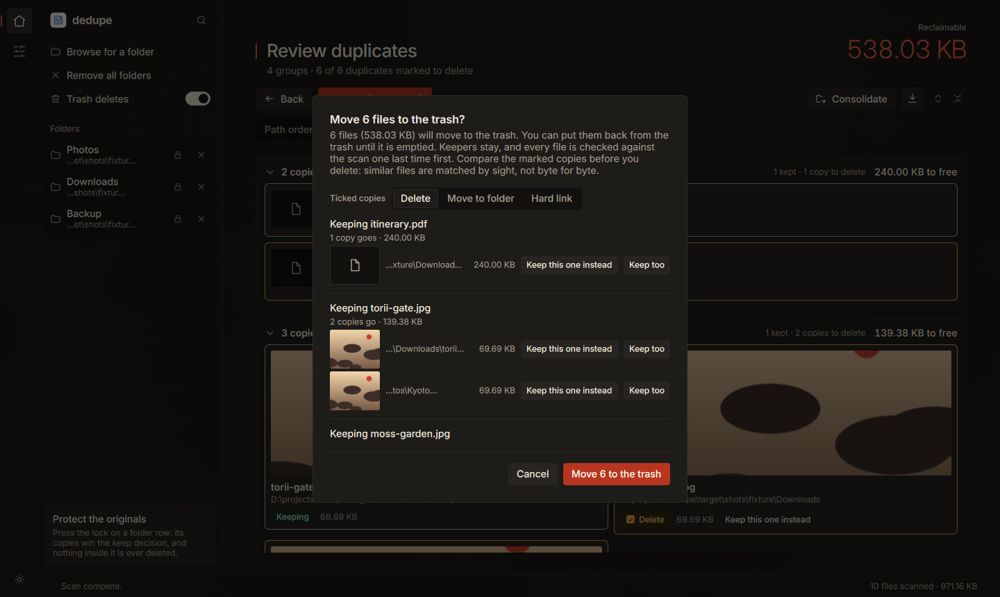

# dedupe



Finds duplicate files — exact copies, and the same photo or video saved twice in a
different format.

Windows, macOS and Linux. One binary: open the desktop app, or run a scan from the
terminal.

## Screenshots

| Home, light | Home, dark |
| --- | --- |
|  |  |

| Results, light | Results, dark |
| --- | --- |
|  |  |

| Before deleting, light | Before deleting, dark |
| --- | --- |
|  |  |

## What it finds

- **Exact duplicates** — same bytes, whatever the file is called or wherever it sits.
- **Similar media** (on by default) — the same picture re-saved as `.png` or `.jpg`,
  the same clip re-encoded to `.mov`. Turn it off with `--exact`.
- **Disk clutter** — empty files and folders, temp files, broken symlinks,
  mislabelled extensions, bad names, the biggest files in a folder, duplicate
  folders, and duplicate music.

## Desktop app

Run `dedupe` with no arguments (or `dedupe --gui`).

1. Add a folder — **Browse** in the sidebar, paste a path into the **New scan**
   form, or drop it on the window — then press **Scan for duplicates**.
2. Results are grouped by content, with the space the ticked copies would free
   shown as **Reclaimable** beside the title. A green **Keeping** badge marks
   the copy that stays, with the reason beside it — "highest resolution
   (4032×3024)", "in a protected folder", "the others look like copies" — an
   amber tick reads **Delete** on a copy ticked to go and **Keep too** on one
   that stays; **Keep this one instead** swaps the keeper (the retiring keeper
   joins the delete list, one untick takes it back), and the reason then reads
   "chosen by you".
3. **Delete** follows your Trash setting: with it on the ticked copies go to the
   system trash, with it off they are deleted permanently (the button and the
   dialog both say which). The dialog lists every group and file that will go
   first, with thumbnails, and offers two gentler ways for the same copies:
   **Move to folder** (moves them into a folder you pick, like `--move-dir`) and
   **Hard link** (replaces each identical copy with a link to its keeper, like
   `--hardlink`). The toolbar button then names the way you picked. **Stop**
   cancels a scan instantly.
4. **Export report…** saves the results as JSON, CSV or HTML, the same reports
   as `--json`, `--csv` and `--html`.

Cleanup scans (empty files, temp files, …) list their findings with a
**Delete** button that follows the Trash setting and confirms first; duplicate
folders stay report-only. **Photo metadata** lists JPEG and PNG photos that
carry EXIF or XMP data and removes it after a confirmation, like `--strip-exif`.

**History** (the clock on the rail) lists every clean-up dedupe has run —
deletes, moves, hard links, Consolidate and metadata removal, from the app and
from the command line — newest first, with when it happened, what it did, how
much space it took and what is already back. **Put back…** opens a
confirmation that lists, file by file, what comes back and what cannot (and
why); a file can be left out of it. Trashed files come back from the trash
(Windows and Linux; on macOS the list says to use the Trash itself), moved and
consolidated ones from their folder. Nothing is ever overwritten: a file whose
place is taken now, or that is gone from the trash or its folder, stays where
it is. Files deleted for good, hard links and removed metadata are listed as
not restorable. Right after a clean-up, **Restore from trash** / **Move back**
on the results page puts that clean-up back the same way.

Folders can be marked as **protected**: their copies win the keep decision and
are never deleted, whatever the scan is looking for. The keep rule (First / Smallest / Newest /
Oldest / Best quality) is chosen on **New scan** and applies to the next scan; a
keeper can still be swapped by hand in any group. When the rule cannot tell two
copies apart (identical files under First, Smallest or Best quality), the one
that looks like the original stays: `photo.jpg` over `photo (1).jpg`,
`photo - Copy.jpg`, `Copy of photo.jpg` or `photo-1.jpg`, and a copy in
Pictures over one in Downloads, Temp, a cache, the trash or a WhatsApp or
Telegram folder; only then does alphabetical order decide. **Consolidate** gathers one copy
of every group into a folder of your choosing, after a confirmation that lists
every move, leaving protected keepers where they are. Settings also cover the scan type, match mode, image
fingerprint and partial clips; light/dark and your preferences persist between
runs.

## Command line

```sh
dedupe ~/Pictures                             # scan and report
dedupe ~/Photos --delete --trash              # review each group, delete to the trash
dedupe /incoming /backup --reference-dir /backup -Dy --trash   # backup always wins
dedupe ~/photos --consolidate-dir ~/sorted -y # gather one copy of everything
dedupe ~/photos --move-dir D:\quarantine -y   # move duplicates aside instead
dedupe ~/photos --hardlink -y                 # replace copies with hard links
dedupe ~/photos --strip-exif -y               # strip EXIF/XMP in place
dedupe ~/downloads --find empty-dirs -D --trash -y  # cleanup scan
dedupe ~/music --find music --music-by content      # needs FFmpeg
dedupe ~/photos --match fuzzy --fuzzy-threshold 90
dedupe ~/photos --csv report.csv --html report.html
dedupe --history                              # every clean-up, with its ID
dedupe --restore 12 --dry-run                 # what would come back, and what cannot
dedupe --restore 12 -y                        # put clean-up #12 back
dedupe --restore 12 ~/Photos/2019 -y          # only its files under that folder
```

Every run that changes files prints its clean-up number; `--history` lists
them all.

`--delete` on its own removes files permanently; add `--trash`, or leave out `-y`
to be asked before anything goes.

Useful flags:

| Flag | What it does |
| --- | --- |
| `--find MODE` | Cleanup mode: `empty-files`, `empty-dirs`, `big-files`, `temp-files`, `invalid-symlinks`, `broken-files`, `bad-extensions`, `bad-names`, `duplicate-folders`, `music`, `photo-metadata` (lists photos `--strip-exif` would clean; never deletes them) |
| `--match` | Group by `content` (default), `size`, `name` or `fuzzy` |
| `--similarity PCT` | How close two images/videos must be (default 97) |
| `--image-hash` | `auto` (dHash), `phash`, `ahash` or `color` |
| `--partial-clips` | Also match a short clip found inside a longer one |
| `--trash` / `--dry-run` | Move to the system trash instead of deleting; or only list what would go |
| `--reference-dir` | Never delete anything inside this folder (repeatable); scan it too to use it as a matching reference |
| `--jobs N` | Worker threads (`0` = all but one core) |
| `--json` / `--csv` / `--html` | Machine-readable, spreadsheet or shareable report |
| `--history` / `--restore ID` | List past clean-ups; put one back (asks first unless `-y`, `--dry-run` only lists) |

Every report says why each group's keeper stays, in the desktop app's words:
the terminal report on the keeper's line, `keep_reason` on each JSON group, a
`keep_reason` column in CSV (filled on the keeper's row) and a Keep reason
column in HTML.

`dedupe --help` has the full list.

## Is my data safe?

- Every file is re-hashed immediately before it is removed — duplicate copies,
  cleanup findings and duplicate tracks alike — and anything that changed
  meanwhile is skipped.
- Nothing inside a `--reference-dir` or a protected folder is ever deleted, in
  any scan mode.
- Duplicate deletions ask once per group unless you pass `-y`; cleanup deletions
  ask once for the whole list. `--trash` moves files to the system trash, where
  they can be restored, instead of removing them outright.
- `--dry-run`, `--move-dir` and `--hardlink` give you ways to clean up without
  losing anything.
- Every clean-up is recorded in `~/.dedupe/history.json` (the newest 200).
  `--history` and the **History** page list them, and `--restore ID` or
  **Put back…** returns what can still come back — never over a file that is
  there now.
- Re-scans are fast: unchanged files are skipped using the size + mtime caches in
  `~/.dedupe/`. `--no-cache` bypasses them without refreshing them;
  `--clear-cache` wipes them.

## Build

```sh
.\build.ps1            # Windows: release binary copied to .\dedupe.exe
cargo build --release  # any OS
```

Rust is the only requirement on Windows and macOS. On Linux the GUI stack also
needs its development packages, as CI installs them: `gcc`, `g++`, `clang`,
`libgtk-4-dev`, `libgstreamer1.0-dev`, `libgstreamer-plugins-base1.0-dev` and
`libwayland-dev`.

FFmpeg is optional for most scans: it adds resolution, duration and codec info,
video comparison, and audio fingerprints for `--music-by content`.

Release downloads: `dedupe.exe` on Windows, the bare binary plus a `dedupe.desktop`
launcher on Linux (put the binary on `PATH` or point `Exec=`/`TryExec=` at it), and
a `dedupe.app` bundle on macOS (for the CLI, run or symlink
`dedupe.app/Contents/MacOS/dedupe`). The GUI never opens a terminal window on any
platform.

The Linux launcher names its icon as a themed name (`Icon=dedupe`), and a desktop
looks that up in the icon-theme directories, not next to the `.desktop` file.
Unpack the archive's `share/` into `~/.local` so the icon lands where it is read:

```
tar -xzf dedupe-*.tar.gz -C ~/.local share
```

The macOS app is ad-hoc signed, not notarized, so the first launch is blocked as
coming from an unidentified developer: open it via right-click → Open (or System
Settings → Privacy & Security → Open Anyway), or clear the download quarantine with
`xattr -dr com.apple.quarantine dedupe.app`.

## How it works

1. Walk the paths, apply the type/size/depth/exclude filters.
2. Group by size, collapse hard links, then partial-hash and fully hash what is
   left (`blake3` by default).
3. Fingerprint the remaining images and videos (dHash on a 17×16 thumbnail; 8
   frames for video) and cluster them at the similarity threshold.
4. Report what can be reclaimed, or delete it after a re-hash.

## Development

```sh
cargo test
cargo clippy --all-targets
```

Commits run `cargo fmt`, `cargo clippy` and file hygiene checks through
[prek](https://prek.j178.dev/), the same ones CI uses (`prek.toml`):

```sh
prek install          # check automatically on commit
prek run --all-files  # check everything now
```

## License

MIT

The desktop app bundles the Inter typeface, under the SIL Open Font License
1.1: see `assets/fonts/OFL.txt`.
