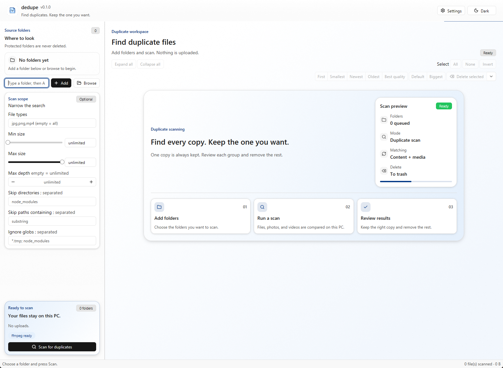
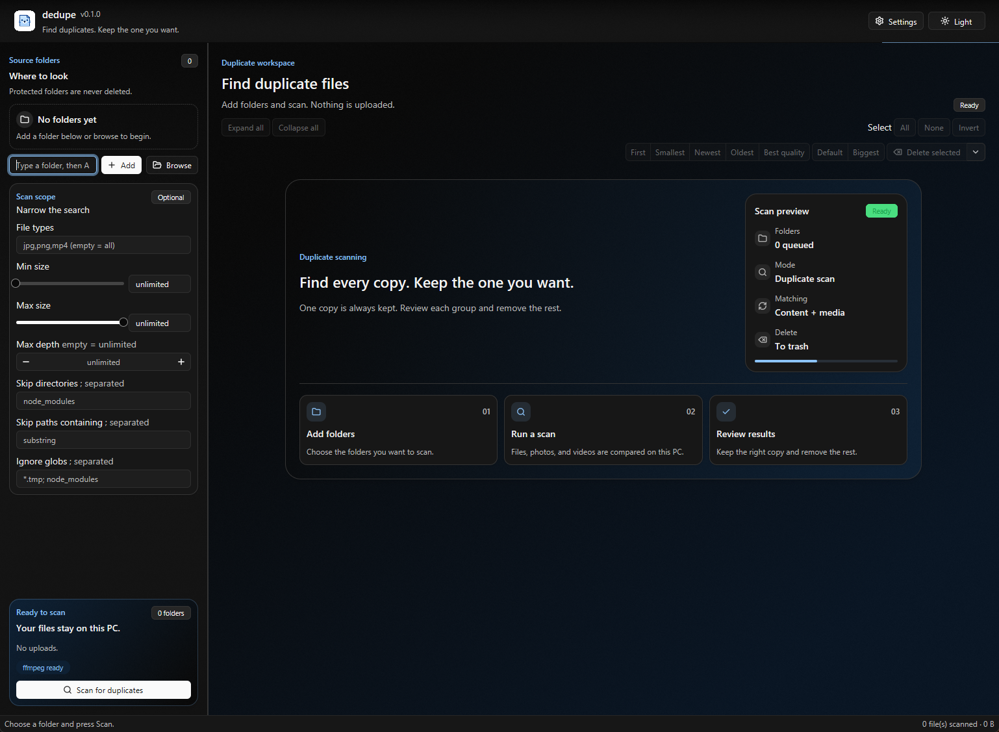
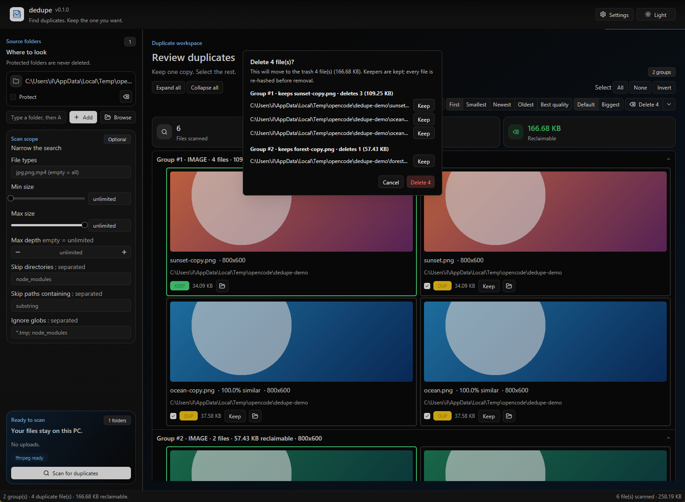

# dedupe


Finds duplicate files — exact copies and similar-looking photos/videos.

- **Exact duplicates** — same bytes. Copies, renames, backups.
- **Similar duplicates** (on by default) — same picture, different format (`.png` vs `.jpg`, `.mp4` vs `.mov`). Disable with `--exact`.

No install. Windows, macOS, Linux.

## Screenshots

| Light | Dark | Delete confirm |
| --- | --- | --- |
|  |  |  |

## Features

### Exact detection

- Size → partial-hash (32 KB head + 32 KB tail) → full-hash; only shared sizes/hashes proceed.
- Hash via `blake3` (default), `sha256`, or `md5`; files ≤ 64 KB hashed whole.
- Hard links count once (up to 2000 files per size group); parallel hashing with `--jobs N` (`0` = auto, all-but-one core).

### Similar media (perceptual, on by default)

- Images: 256-bit dHash over a 17×16 thumbnail by default; `--image-hash phash|ahash|color` switches the fingerprint family (`auto` keeps dHash for compatibility).
- Videos: 8 frames via `ffmpeg` (fast pass ≤ 90 s, seeks above), symmetric sequence match ±2 frames.
- `--partial-clips` also finds a shorter clip contained inside a longer one (`--partial-similarity PCT`, default `85`).
- `--similarity PCT` tunes threshold (default `97`); `--exact` disables the pass.
- Bucketed by aspect ratio (images) / resolution (videos, duration-checked at match time); deterministic star clustering, no chained groups.

### Cleanup modes

`--find` scans for one problem at a time instead of hashing duplicates:

- `empty-files`, `empty-dirs`, `big-files` (`--top N`, default 50), `temp-files`
- `invalid-symlinks`, `broken-files` (undecodable images / unplayable media)
- `bad-extensions` (extension does not match the file's magic bytes)
- `bad-names` (reserved names, invalid characters, trailing dots/spaces)
- `duplicate-folders` (identical directory trees by content signature)
- `music` — duplicate tracks by embedded tags (`--music-by tags`) or audio fingerprints (`--music-by content`)

Findings honour `--ignore GLOB` (repeatable), `--types`, size limits, depth and the exclude flags. Actions: `--delete` / `--trash` / `--dry-run`; `duplicate-folders` is report-only.

### Flexible matching

`--match size|name|fuzzy` groups by content (default), size only, exact base name, or fuzzy base name (`--fuzzy-threshold PCT`, default `85`). Name matching ignores copy suffixes such as `- Copy (2)`.

### Safe deletion

- Every file re-hashed before removal; changed files are skipped, never deleted.
- `--trash` recovers via system trash; `--dry-run` only lists (per-group subtotals included); prompts per group (`y/n/a/q`) unless `-y`.
- `--move-dir DIR` moves duplicates to a quarantine folder instead of deleting; `--hardlink` replaces duplicates with hard links to the keeper and reports bytes saved.
- `--strip-exif` removes EXIF/XMP metadata from JPEG and PNG images in place (dry-run unless `-y`).
- `--reference-dir PATH` (repeatable) never deleted and always keeps; keeper is smallest path by default, or `--keep-smaller` / `--keep-newest` / `--keep-oldest` / `--keep-best-quality` (highest resolution, then longest duration, then largest file).
- `--consolidate-dir DIR` gathers each group's keeper into one folder (flattened, collisions gain a ` (2)` suffix; reference keepers stay put). Every keeper is re-hashed before moving.

### Scope, reports, cache

- Scan files/dirs; filter with `--types`, `--min-size`/`--max-size`, `--max-depth`, `--exclude-dir`/`--exclude-path`, `--ignore GLOB`.
- Human report (`✓ KEEP` / `✗ DUP` / `◈ REF`) or `--json`; `--verbose` adds codec metadata, `--quiet` silences progress.
- Export alongside the normal report: `--csv FILE` and `--html FILE` (mode findings and duplicate groups).
- Caches in `~/.dedupe/` (`hashes.bin` ≥ 256 KB files, `fingerprints.bin`), keyed by size+mtime; `--no-cache` bypasses, `--clear-cache` wipes them (Settings page in the GUI too).
- Optional `ffprobe`/`ffmpeg` add resolution/duration/codec and video comparison; everything else works without them.

### GUI

```sh
dedupe-gui     # desktop app, no terminal
dedupe         # desktop app + terminal
dedupe --gui   # same, explicit
```

- Same pipeline as CLI; opens when no path given; pick folders, **Scan**, tick, **Delete N** (trash by default; the tooltip carries the total bytes). **Stop** (replaces Scan while running) cancels instantly — the view resets right away and the pipeline winds down in the background.
- Settings → Preferences picks the scan type (duplicates or a cleanup mode), duplicate matching (`content`/`size`/`name`/`fuzzy`), image fingerprint, partial-clip detection, and music matching. Cleanup-mode findings are read-only in the GUI; use the CLI with `--delete` or `--trash` to act on them.
- **Consolidate** gathers every group's keeper into one folder (two clicks: pick folder, confirm).
- Per-folder **Protect** (never deleted), **Keep** switch without rescanning (First / Smallest / Newest / Oldest / Best quality), thumbnails + cached video poster strips, JSON export, light/dark + prefs persisted.

> GUI builds need VS 2022 C++ workload on Windows ([details](https://gpui-kit.com/docs/installation)).

## CLI

```sh
dedupe <path>...                                   # scan
dedupe /media --delete                             # delete (prompts per group)
dedupe /incoming --reference-dir /backup -Dy --trash  # safe cleanup, no prompts
dedupe /photos --consolidate-dir /sorted -y          # gather one copy of everything
dedupe /photos --move-dir D:\quarantine -y           # move duplicates aside
dedupe /photos --hardlink -y                         # replace copies with hard links
dedupe /photos --strip-exif -y                       # remove EXIF/XMP in place
dedupe /downloads --find empty-dirs --delete -y      # cleanup scan
dedupe /music --find music --music-by content        # duplicate tracks by audio
dedupe /photos --match fuzzy --fuzzy-threshold 90    # near-identical names
dedupe /photos --csv report.csv --html report.html   # export the report
```

Flags: `--find` · `--match` · `--fuzzy-threshold` · `--top` · `--image-hash` · `--partial-clips` · `--partial-similarity` · `--music-by` · `--csv` · `--html` · `--move-dir` · `--hardlink` · `--strip-exif` · `--ignore` · `--types` · `--keep-smaller`/`--keep-newest`/`--keep-oldest`/`--keep-best-quality` · `--reference-dir` · `--consolidate-dir` · `--trash` · `--dry-run` · `--exact` · `--similarity` · `--no-cache` · `--clear-cache` · `--jobs` · `-y` · `--json` · `--verbose` · `--quiet`. Full list: `dedupe --help`.

## Build

```sh
.\build.ps1            # Windows: release -> dedupe.exe + dedupe-gui.exe
cargo build --release  # any OS
```

Needs Rust; optional FFmpeg for media metadata + video comparison (`dedupe.exe` = CLI+GUI, `dedupe-gui.exe` = GUI only, no console).

## Build cache (kache)

Builds go through [Kache](https://github.com/kunobi-ninja/kache), a content-addressed
compiler cache that keeps `rustc` output from being rebuilt in every target dir.

- Machine setup: `kache` 1.2.2 in `~/.local/bin`, `rustc-wrapper = "kache"` in
  `~/.cargo/config.toml`, daemon running as the `kache-daemon` login task. This is
  machine-wide, not committed — `cargo` commands in this repo need no changes.
- Policy lives in `~/.config/kache/config.toml` (the file the daemon watches): 8 GiB
  store cap, 30-day entry expiry, zstd level 6, skip sub-200 ms compiles, remove
  orphaned target dirs and units unused for 30 days. A repo `.kache.toml` would only
  change the client process and silently disagree with GC, so there is none.
- Measured here: cold `cargo check` 2m15s → 463 entries / 653 MiB stored; the same
  check in a second target dir 19.7 s, 276 restores, ~9 min of compile work avoided.

On **NTFS** every restore is a byte copy (no block cloning, and the hardlink carrier
is Unix-only — `kache stats` reports `0.0% without copying`), so the cache does not
share blocks with `target/`: expect the store to *add* its 653 MiB rather than shrink
the build tree. Space is reclaimed by the cleanup policy and the cap, not by clones.
The `Link layout: EXDEV` line in `kache doctor` is expected for the same reason —
moving the store onto `D:` would not make restores zero-copy.

```sh
kache stats                      # hit rate, time saved, store size
kache clean --dry-run            # what a cleanup would free, per target dir
kache clean --stale 30d --yes    # delete target dirs idle for 30 days
kache clean --cache              # empty the store (keeps target/)
KACHE_DISABLED=1 cargo build     # bypass the cache for one command
```

Remove it entirely with `kache daemon uninstall` and by deleting the
`rustc-wrapper` line from `~/.cargo/config.toml`.

## How it works

Shared pipeline (`pipeline::run_scan`): Scanning → Hashing → Comparing media → Building report.

1. Walk paths, apply `--types`/size/depth/exclude filters; record unreadable paths without aborting.
2. Group by size; collapse hard links; partial-hash survivors, keep shared buckets.
3. Full-hash survivors (cache-assisted); identical hashes form exact groups, keeper picked, `ffprobe` metadata attached.
4. Similar pass: leftovers plus each exact group's keeper are bucketed and fingerprinted (dHash / 8 video frames), then star-clustered at `--similarity`; a rescaled or re-encoded variant merges into its byte-identical group instead of forming a separate one, and per-member content hashes are stored.
5. Print human/JSON with reclaimable bytes; on `--delete`, prompt then re-hash and delete (trash/permanent).

Repeat scans skip unchanged files via size+mtime caches (`hashes.bin`, `fingerprints.bin`).

## Tests

```sh
cargo test
cargo clippy --all-targets
```

## Git hooks

Pre-commit checks run via [prek](https://prek.j178.dev/) (fast `pre-commit`
alternative): `cargo fmt`, `cargo clippy`, plus whitespace/file hygiene —
same checks as CI (`prek.toml`).

```sh
prek install            # run checks automatically on `git commit`
prek run --all-files    # run all checks on demand
```

## License

MIT
